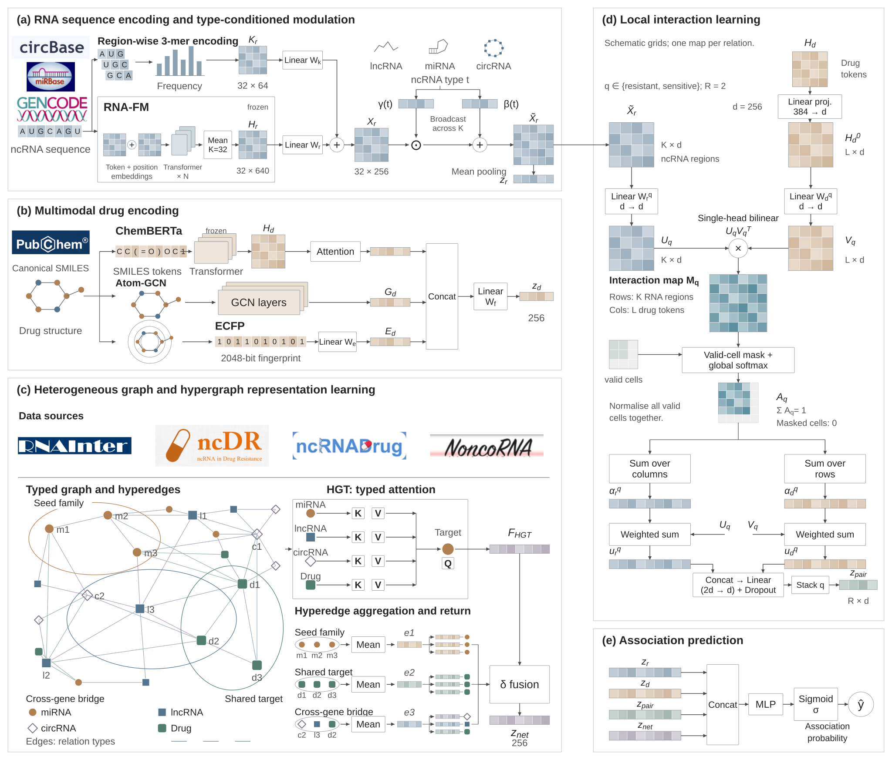
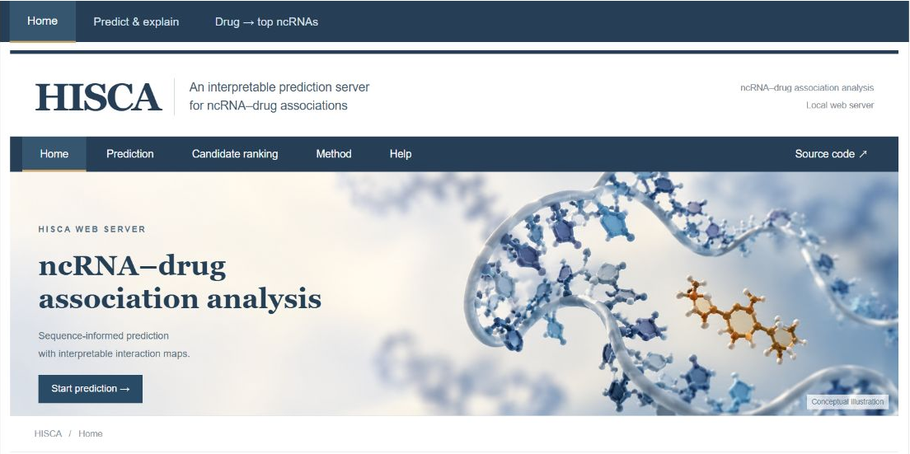

# HISCA

## Welcome to HISCA

**HISCA: Heterogeneous-graph and Interpretable Substructure Co-Attention for ncRNA–drug association prediction.**

HISCA is a research framework for predicting associations between non-coding RNAs (miRNAs, lncRNAs and circRNAs) and drugs. It combines RNA sequence representations, molecular features and heterogeneous network information with local region–substructure interactions. This repository provides the model implementation, feature preparation scripts, training and evaluation code, and an installable local web platform.

The framework includes:

- **RNA representation learning:** RNA-FM embeddings, region-wise k-mer features and ncRNA type-conditioned modulation.
- **Multimodal drug encoding:** ChemBERTa token representations, molecular graph features and ECFP fingerprints.
- **Network representation learning:** heterogeneous graph attention, with optional hypergraph integration for research configurations.
- **Local interaction learning:** relation-specific single-head bilinear interactions between RNA regions and drug tokens, followed by masked global softmax and interaction pooling.

The conceptual workflow of HISCA is shown below:



*Figure 1. Conceptual research overview. The diagram summarizes the main representation and interaction pathways; exact operations and enabled modules are defined by the source configuration. The released web platform uses the fixed inference profile described in [Web Platform and Local Deployment](#web-platform-and-local-deployment).*

## Directory Structure

```text
HISCA/
├── models/
│   ├── config.py                 # Model configuration and data paths
│   ├── dataset.py                # Data loading and graph construction
│   ├── layers.py                 # Neural network components
│   ├── model.py                  # Model architectures
│   ├── main.py                   # Training and evaluation entry point
│   └── utils.py                  # Sampling, splitting and evaluation utilities
├── preprocessing/                # Sequence, molecular and target feature preparation
├── web/
│   ├── app.py                    # Gradio prediction platform
│   ├── check_deployment.py       # Deployment file checks
│   ├── interpretation.py         # Drug token grouping for interaction maps
│   ├── home.html                 # Platform home page
│   └── assets/                   # Home page illustrations
├── src/hisca/                    # Installable launcher and environment initialization
├── requirements/
│   ├── web.txt                   # Pinned inference dependencies
│   └── research.txt              # Research and feature preparation dependencies
├── docs/
│   └── images/                   # Framework diagram and platform screenshot
├── tests/                        # Launcher regression checks
├── setup.py                      # Python package build configuration
└── README.md
```

Model weights, data tables and precomputed features are distributed in the [full release package](https://github.com/BbaiYyu/HISCA/releases/tag/v0.3.1). They are not included in the Git source archive.

## Installation and Requirements

Use **64-bit Python 3.9–3.12**. The complete local inference workflow has been tested on **Windows with Python 3.9.23 and CPU-only PyTorch**. A GPU is not required for the released web platform.

Key versions in the tested inference environment are:

| Library | Version |
|---|---|
| PyTorch | 2.6.0+cpu |
| PyTorch Geometric | 2.6.1 |
| Transformers | 4.44.2 |
| NumPy | 2.0.2 |
| scikit-learn | 1.6.1 |
| Gradio | 4.44.1 |

See [requirements/web.txt](requirements/web.txt) for all inference pins and [requirements/research.txt](requirements/research.txt) for additional research dependencies. Feature generation may require downloads of pretrained RNA, molecular or protein encoders. Research environments should record the actual dependency versions and experiment settings.

To use the platform without working with the research code, go directly to [Web Platform and Local Deployment](#web-platform-and-local-deployment).

## Running the Research Code

Run the following commands from the repository root.

### Step 1: Download the Code and Prepare an Environment

```bash
git clone https://github.com/BbaiYyu/HISCA.git
cd HISCA
python -m venv .venv
```

Activate the environment on Windows PowerShell:

```powershell
.\.venv\Scripts\Activate.ps1
```

On Linux/macOS, use `source .venv/bin/activate`. The commands below use the tested CPU inference stack as a starting point, then add the research dependencies:

```bash
python -m pip install torch==2.6.0 --index-url https://download.pytorch.org/whl/cpu
python -m pip install -r requirements/web.txt
python -m pip install -r requirements/research.txt
```

### Step 2: Prepare the Data and Features

The default source layout expects the following folders at the repository root:

```text
HISCA/
├── data/
│   ├── drugs.csv
│   ├── merged_clean.csv
│   ├── ncRNA.csv
│   └── drug_targets.csv
├── features/
│   ├── rna_feats.pt
│   ├── drug_feats.pt
│   ├── target_feats.pt
│   ├── rna_kmer.pt
│   ├── drug_extra.pt
│   └── drug_graphs.pt
├── ckpt/
│   └── hisca_demo.pt
└── tokenizer/
```

For the released data and model, download the full `.whl` from [Releases](https://github.com/BbaiYyu/HISCA/releases/tag/v0.3.1). A wheel is a ZIP-format archive: extract it into a separate folder, then copy `data/`, `features/`, `ckpt/` and `tokenizer/` from `hisca/_bundle/` into the repository root. Keep the supplied feature mappings, node order and checkpoint together.

For new research data, the `preprocessing/` scripts provide entry points for RNA and drug encoders, k-mer features, ECFP fingerprints, molecular graphs and target features. Each script requires its corresponding input tables and external resources. Optional high-order hyperedges can be prepared with `preprocessing/build_hyperedges_v2.py` for a matching research configuration.

### Step 3: Run Training and Evaluation

Inspect the available options, then run five-fold evaluation with the v2 architecture and degree-matched negatives:

```bash
python models/main.py --help
python models/main.py --arch v2 --neg degree --folds 5
```

The script prints per-epoch and per-fold metrics, followed by their mean and standard deviation. It supports random, degree-matched and random-forest-based negative sampling, as well as ncRNA or drug cold-start splits. For example:

```bash
python models/main.py --arch v2 --neg rf --evalneg degree --folds 5
python models/main.py --arch v2 --neg degree --coldstart ncRNA
```

`--evalneg` controls evaluation negatives separately only when `--neg rf` is selected. The training entry point reports evaluation results; it does not automatically export the web deployment checkpoint.

## Web Platform and Local Deployment

The HISCA web platform provides a browser interface for local inference using a released checkpoint and precomputed features.



*Figure 2. HISCA platform home page. The cover artwork is a conceptual illustration.*

| Function | Input and output |
|---|---|
| **Pair prediction** | Select an existing ncRNA and drug to obtain an association score. |
| **Interaction visualization** | View relative interaction strength between RNA regions and grouped drug substructures. |
| **Candidate ranking** | Select a drug and rank Top-K ncRNA candidates, with ncRNA type filtering. |

### Step 1: Install the Full Package

Install 64-bit Python 3.9–3.12, then run:

```bash
python -m pip install "https://github.com/BbaiYyu/HISCA/releases/download/v0.3.1/hisca_web-0.3.1%2Bfull.20261020-py3-none-any.whl"
```

The full package is approximately **720 MiB** and includes the web interface, images, trained weights, deployment data, six precomputed feature files and a local tokenizer. No separate model training is needed. First-time environment setup requires Internet access to download dependencies.

Use this release URL when installing HISCA; the project is not currently published to PyPI.

### Step 2: Start HISCA

```bash
hisca
```

On the first start, the launcher creates an isolated CPU environment, installs the inference dependencies, loads the model and opens the browser when the server is ready. Later starts reuse the environment. If `hisca` is not found, run `python -m hisca` with the same Python used for installation.

The service listens on `127.0.0.1` and selects an available local port. Keep the terminal open while using the platform; press **Ctrl+C** to stop it.

### Windows Double-Click Installation

Download the full wheel together with [install_and_start.bat](https://github.com/BbaiYyu/HISCA/releases/download/v0.3.1/install_and_start.bat) and [start_hisca.bat](https://github.com/BbaiYyu/HISCA/releases/download/v0.3.1/start_hisca.bat) from the [release page](https://github.com/BbaiYyu/HISCA/releases/tag/v0.3.1), and keep them in the same folder.

After installing Python and adding it to PATH, double-click `install_and_start.bat` for the first run. It uses the local wheel if present and otherwise downloads it. Use `start_hisca.bat` for subsequent starts. The release also includes `SHA256SUMS.txt` for download verification.

### Runtime Options

```bash
hisca --home "D:\HISCA-runtime"
hisca --setup-only
hisca --no-browser
hisca --port 7870
```

On Windows, the default environment, cache and log directory is `%LOCALAPPDATA%\HISCA`. Use the same `--home` value on later starts, or set `HISCA_HOME`, to reuse a custom directory. For startup failures, inspect the `logs/server-*.log` file shown in the terminal.

### Run the Web Interface from Source

After preparing the source environment and the matching bundle folders above, run the following in PowerShell from the repository root:

```powershell
$env:NCDRUG_TOKENIZER_DIR = (Resolve-Path .\tokenizer).Path
$env:HF_HUB_OFFLINE = "1"
$env:NCDRUG_V2_HYPER = "0"
$env:NCDRUG_INT_CENTER = "0"
$env:NCDRUG_INT_NORM = "0"
python web/check_deployment.py
python web/app.py
```

The web checkpoint is `ckpt/hisca_demo.pt`. The released launcher uses `arch=v2`, retains heterogeneous graph features, and disables optional v2 hypergraph integration, interaction centering and interaction normalization to match this checkpoint. Keep these settings and the supplied features together when reproducing deployment behavior.

The current platform accepts ncRNAs and drugs from its built-in lists. It uses the full known association graph for deployment; deployment predictions are not an independent held-out evaluation. Scores and relative interaction maps are intended for research exploration.

## License

The source code is distributed under the [MIT License](LICENSE).
